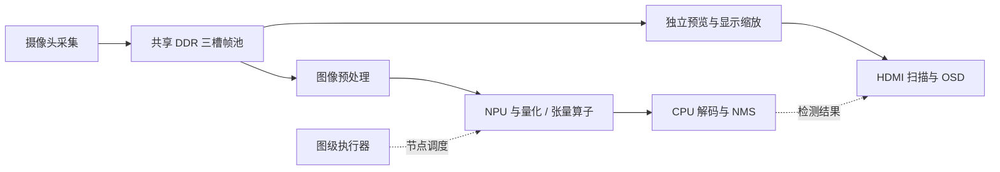

# RISC-V FPGA SoC

面向 Pango PG2L200H 的异构 SoC 源码集合，包含 RV32 乱序双发射 CPU、
图级执行器与 NPU、Linux 适配、图形外设交互四个独立工程。

## 目录

| 目录 | 作用 |
| --- | --- |
| [cpu/](cpu/) | CPU、分支预测、Cache/TCM、板级接口和 CoreMark 平台软件 |
| [YOLO/](YOLO/) | 摄像头、帧池、图像预处理、图级执行器、NPU、后处理和显示链路 |
| [Linux/](Linux/) | 特权架构、Sv32、板级 RTL、Linux 驱动、GUI、启动及传输工具 |
| [Game/](Game/) | 软件模拟器适配、GPIO 输入、定时器、DDR 帧缓冲与 HDMI 验证 |
| [docs/](docs/) | 构建、接口边界、目录来源和许可范围说明 |
| [LICENSES/](LICENSES/) | 第三方许可证正文 |

四工程共享部分处理器与外设设计，分别使用对应的 RTL、固件和 FPGA 配置。
各工程的时钟、地址布局和软件镜像应成套使用。

## 视觉推理链路



采集、预览和推理通过帧所有权跨帧协作。图级执行器依据节点依赖和完成响应
推进算子链；CPU 负责帧管理与后处理。

## 获取与校验

```sh
git clone https://github.com/r03312317-cloud/riscv-fpga-soc.git
cd riscv-fpga-soc
python 校验代码包.py
```

校验脚本仅使用 Python 标准库，读取根目录清单并核对文件大小和 SHA-256。
它不执行综合、固件下载或硬件访问。

## 构建与验证

参见 [构建说明](docs/BUILD.md) 与 [验证范围](docs/VERIFICATION.md)。
厂商 IP 和商业游戏 ROM 不随源码分发，固件初始化文件应由当前源码重新生成。
历史构建快照和辅助工具保留在各自子目录；当前文件完整性以根目录清单为准。

## 许可范围

独立自研代码采用 [MIT](LICENSE)。CoreMark、OpenSBI、Linux/BusyBox、
psplash、LiteNES、LVGL、musl、pySerial 和字体分别遵循各自许可。
模型的训练/导出来源涉及 AGPL-3.0，模型与派生常量不包含在本项目额外授予的
MIT 范围内，详见 [模型来源说明](YOLO/model/NOTICE.md)。

[第三方许可索引](THIRD_PARTY_NOTICES.md) 列出具体位置；
[目录与来源审查](docs/SOURCE_AND_LICENSE_AUDIT.md) 说明独立软件、参考副本和许可边界。
